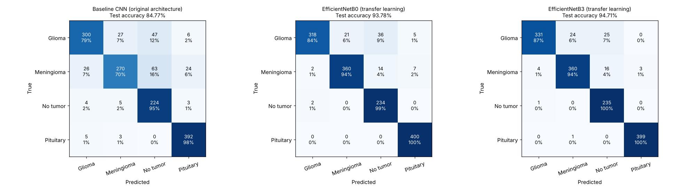
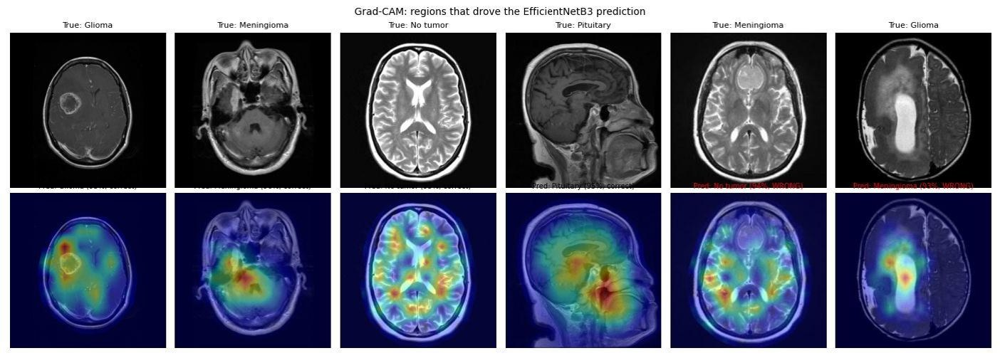
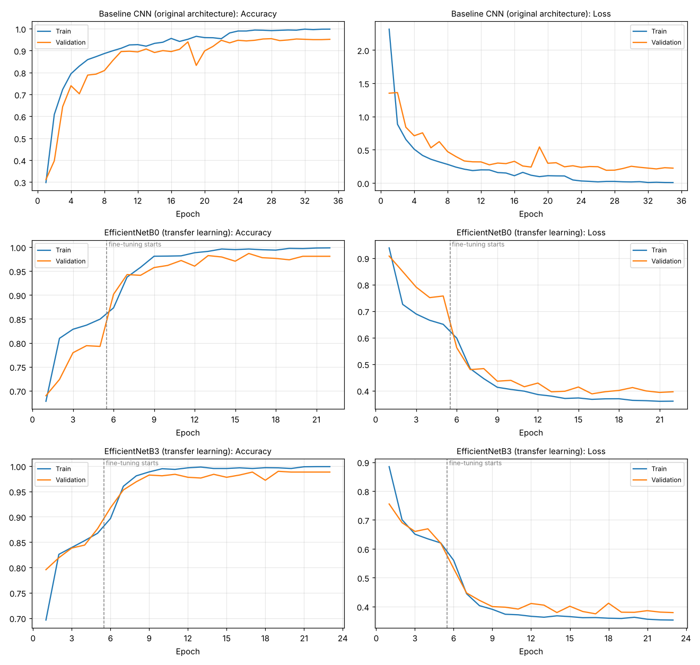

# Brain MRI Tumor Classifier

Classifies brain MRI scans into four classes (**glioma, meningioma, pituitary tumor, no tumor**) with deep learning, using a **leakage-free evaluation protocol** and **Grad-CAM** explanations.

[](https://colab.research.google.com/github/AakashRanjan1811/Brain-MRI-Tumor-Classifier/blob/main/notebooks/train_colab.ipynb)

## Highlights

- **94.71% test accuracy** (macro F1 94.38%, macro ROC-AUC 0.992) with EfficientNetB3 transfer learning, up from **84.77%** for the CNN trained from scratch.
- **Found and removed data leakage in the public dataset:** 720 training images were duplicates of test images, and 201 duplicate copies inside the test set were removed. Every number in this README is measured on the **de-duplicated** test set, which no model saw during training; checkpoints are selected on a separate validation split.
- **Explainability:** Grad-CAM heatmaps show which regions of the scan drove each prediction.
- **Reproducible:** one command (or one Colab notebook) runs de-duplication → training → evaluation → figures; about 47 minutes on a free Colab T4 GPU.

## Results

Test set: 1,399 images (official Kaggle test split after de-duplication).

| Model | Input | Params | Test accuracy | Macro precision | Macro recall | Macro F1 | Macro ROC-AUC |
|---|---|---|---|---|---|---|---|
| Baseline CNN (from scratch) | 150×150 | 4.4M | 84.77% | 84.34% | 85.59% | 84.01% | 0.953 |
| EfficientNetB0 (transfer learning) | 224×224 | 4.1M | 93.78% | 93.18% | 94.21% | 93.34% | 0.988 |
| EfficientNetB3 (transfer learning) + flip TTA | 300×300 | 10.8M | **94.71%** | 94.10% | 95.11% | **94.38%** | 0.992 |
| *Original v1 notebook (for reference)* | 150×150 | 4.4M | *85.13%¹* | | | | |

TTA = test-time augmentation: the prediction is averaged over the image and its horizontal flip. ¹ The v1 number was measured on the original test split, which shares 720 duplicated images with the training set, and the test set was also used as the validation set during training, so it is not comparable. Re-trained correctly, the same CNN architecture scores 84.77% on the clean test set.

**Per-class results (EfficientNetB3):**

| Class | Precision | Recall | F1 |
|---|---|---|---|
| Glioma | 98.51% | 87.11% | 92.46% |
| Meningioma | 93.51% | 93.99% | 93.75% |
| No tumor | 85.14% | 99.58% | 91.80% |
| Pituitary | 99.25% | 99.75% | 99.50% |



### Grad-CAM

EfficientNetB3 on test images. Top row: input scan. Bottom row: Grad-CAM heatmap of the regions that drove the predicted class (red = most influential). The first four columns are the most confident correct prediction per class; the last two are the most confident mistakes. Heatmaps are computed from the class logit on the last feature map and shown only over the head region: without that mask every map has the same bright spot in the image corner, a known border artifact of EfficientNet's final feature map.



### Training curves



## Data leakage in the Kaggle dataset

The [Brain Tumor MRI Dataset](https://www.kaggle.com/datasets/masoudnickparvar/brain-tumor-mri-dataset) merges three public sources (figshare, SARTAJ, Br35H), and many scans appear more than once: re-saved, resized or slightly re-cropped. Duplicates **across** train and test inflate test accuracy, because the model is partly scored on images it trained on.

Duplicates are detected with a 256-bit perceptual difference hash (dHash), which survives re-encoding and resizing (exact byte comparison finds only a fraction of them). Images whose hashes differ by at most 10 of 256 bits are grouped; a visual check of sampled pairs confirmed they are the same scan. Then:

| Step | Images |
|---|---|
| Original split | 5,600 train / 1,600 test |
| Train images duplicated in test (removed from train) | 720 |
| Other removals: duplicates within train / within test (one copy kept) and 2 groups with conflicting labels | 353 / 201 |
| **Final** | **3,847 train / 680 validation / 1,399 test** |

The "no tumor" class is the most duplicated, so after cleaning it has far fewer unique training images; balanced class weights compensate for this.

For reference, the same EfficientNetB3 model scores 94.62% on the **original** 1,600-image test split. The two numbers are close because the 720 overlapping images were removed from *training*. A model trained on the original split (like v1) would have seen those 720 test images during training, so its test score would partly measure memorisation.

## Method

| | |
|---|---|
| **Split** | Stratified 85/15 train/validation split of the de-duplicated training set. The test set is used only for the final evaluation. |
| **Baseline** | The original CNN of this project (9 conv layers + 2 dense, 4.45M params), trained with pixel scaling, He initialisation, early stopping and best-checkpoint restore. |
| **Transfer learning** | EfficientNet pretrained on ImageNet, with a new head (global average pooling → dropout 0.3 → softmax). Phase 1: backbone frozen, head trained (Adam 1e-3, 5 epochs). Phase 2: whole backbone fine-tuned with BatchNorm frozen (Adam 1e-4, up to 30 epochs). |
| **Regularisation** | Augmentation (horizontal flip, ±18° rotation, 10% zoom/translation, contrast jitter), label smoothing 0.1, dropout, balanced class weights. |
| **Training control** | Early stopping on validation loss, LR reduced ×0.3 on plateau, weights restored from the best validation epoch. |
| **Evaluation** | Accuracy, macro precision/recall/F1, one-vs-rest ROC-AUC, confusion matrix; Grad-CAM (class-logit gradients, last feature map). |

## Project structure

```
├── notebooks/
│   ├── train_colab.ipynb        # one-click GPU run on Google Colab
│   └── original_cnn_v1.ipynb    # first version of the project (kept for reference)
├── src/
│   ├── config.py                # classes, seed, split fraction
│   ├── data.py                  # perceptual-hash de-duplication, splits, tf.data pipeline
│   ├── models.py                # baseline CNN, EfficientNet transfer model
│   ├── train.py                 # two-phase training, callbacks
│   ├── evaluate.py              # metrics, confusion matrix, ROC-AUC, TTA
│   ├── gradcam.py               # Grad-CAM heatmaps
│   ├── plots.py                 # figures from results/metrics.json
│   ├── dedup_report.py          # duplicate-detection diagnostics
│   ├── make_gradcam.py          # regenerate Grad-CAM from a saved model
│   └── run.py                   # end-to-end pipeline (CLI)
├── results/
│   ├── metrics.json             # all metrics, training histories, split statistics
│   └── figures/
└── requirements.txt
```

## How to run

**Colab (recommended):** open the notebook with the badge above, choose *Runtime → Change runtime type → T4 GPU*, and run the cells.

**Locally (GPU recommended):**

```bash
pip install -r requirements.txt
python -m src.run --out results                                  # baseline + EfficientNetB0
python -m src.run --out results_b3 --skip-baseline --backbone b3 --tta
```

The dataset is downloaded automatically with `kagglehub`; pass `--data-dir` to use a local copy (a folder containing `Training/` and `Testing/`). Trained models are saved to `results/models/` (not committed; about 47 minutes to reproduce).

## Limitations

- Single dataset and single test split. The sources mix scanners and preprocessing, so performance on images from another hospital may be lower.
- EfficientNetB3 was trained after seeing the EfficientNetB0 test result, which is a mild form of test-set model selection; both results are reported above rather than only the best one.
- Patient IDs are not available, so different slices of the same patient can still fall into different splits (the hash removes near-identical copies, not neighbouring slices).
- This is a learning project, **not a medical device**, and must not be used for diagnosis.

## Acknowledgments

Dataset: [Brain Tumor MRI Dataset](https://www.kaggle.com/datasets/masoudnickparvar/brain-tumor-mri-dataset) by Masoud Nickparvar (figshare, SARTAJ and Br35H collections).
